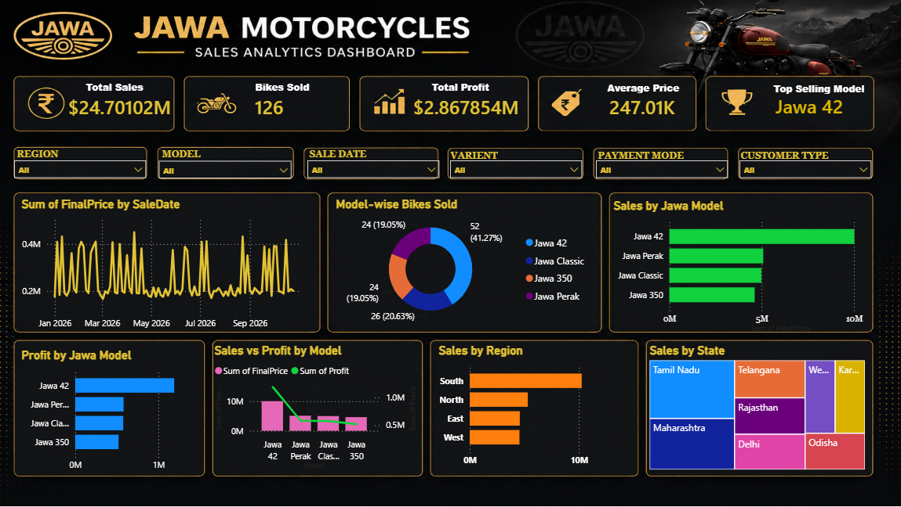

# JAWA-MOTOR-CYCLE-SALES-ANALYTICS-DASHBOARD

# 📌 Project Overview

This project focuses on building an interactive Power BI dashboard to analyze JAWA Motorcycle sales performance, revenue trends, product performance, and sales patterns. The goal is to transform sales data into meaningful business insights and support data-driven decision-making.

# 📂 Project Steps

# 1️⃣ Data Collection

- Collected motorcycle sales data for analysis.
- Included relevant fields such as motorcycle models, sales, revenue, product categories, regions, and dates, depending on the available dataset.

# 2️⃣ Data Cleaning & Preparation (Power Query)

- Checked and handled missing and duplicate values.
- Standardized text values and column names.
- Corrected data types and date formats.
- Prepared the dataset for accurate analysis and visualization.

# 3️⃣ Data Modeling

- Organized sales data for dashboard reporting.
- Created relationships between tables if multiple datasets were used.
- Ensured the data structure supported accurate filtering and analysis.

# 4️⃣ DAX Measures Creation

### Key measures developed:

- Total Sales
- Total Revenue
- Total Quantity Sold
- Average Sales
- Model-wise Sales Performance
- Category-wise Sales Analysis

# 5️⃣ Dashboard Design

Designed an interactive Power BI dashboard featuring:

- KPI Cards for key sales metrics
- Sales Performance Overview
- Model-wise Sales Comparison
- Sales Trend Analysis
- Category-wise Sales Analysis
- Interactive Slicers for filtering data

### Visuals Used:

- Bar Charts and Column Charts
- Line Charts
- Cards and KPI Visuals
- Tables and Slicers

# 6️⃣ Insights Delivered

- Identified high-performing motorcycle models.
- Analyzed sales trends and revenue performance.
- Compared sales across available product categories.
- Highlighted key performance indicators to understand business performance.

# 7️⃣ Final Output

### An interactive Power BI dashboard enabling:

- Clear visualization of motorcycle sales performance
- Dynamic filtering and data exploration
- Faster identification of sales trends
- Data-driven business decision-making

# 🛠️ Tools & Technologies

- Microsoft Power BI
- Power Query
- DAX
- Data Cleaning
- Data Visualization
- Business Intelligence

# 🎯 Project Objective

To develop an interactive sales analytics dashboard that converts raw JAWA Motorcycle sales data into meaningful insights for monitoring performance and supporting business decisions.
